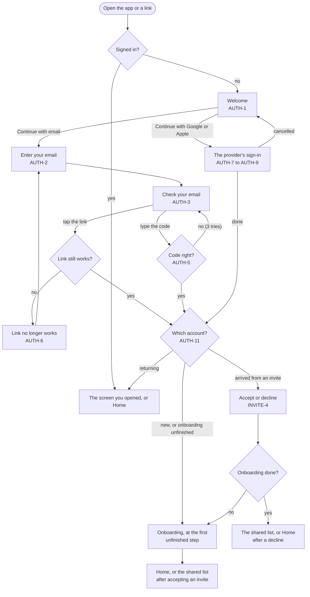
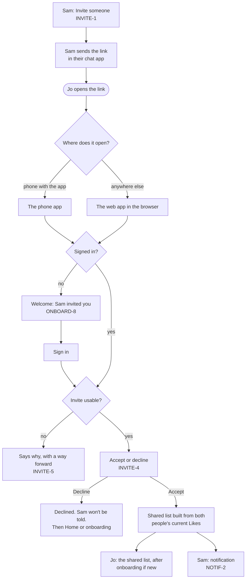
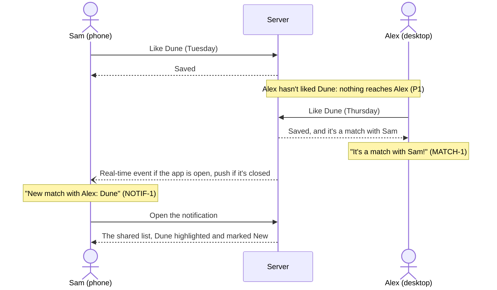

# Screens and navigation

Every screen and dialog in Movie Mates, how you move between them on each client, and the web addresses and
links that open them. The stories are in [`features/`](requirements.md#where-the-stories-are); this file
says where each one lives. The [wireframes](../design/wireframes/README.md) draw these screens, and the clients
build them.

Rules from the [decisions](requirements.md#6-decisions) that shape everything here:

- **Nothing scrolls or swipes sideways** (decision 17): no carousels, no swiping between tabs or pages, no
  sideways rows. Every screen scrolls down.
- **Grids grow with Show more** (decision 18), and **Back** returns to the same place, with the same number
  of titles shown.
- **Signed out, the only screen is the welcome screen** (decision 2). Any other address opens it first, then
  goes on to that screen after sign-in (AUTH-11).
- **Offline, a banner says so on every screen** (decision 20). Navigation keeps working between screens
  already loaded.

**Contents:** [Screens](#1-screens) · [Kinds of screen](#2-full-screen-dialog-sheet-or-menu) ·
[Navigation](#3-navigation-per-client) · [Flows](#4-flows) · [Web addresses](#5-web-addresses) ·
[Deep links](#6-deep-links) · [Desktop and web](#7-desktop-and-web)

---

## 1. Screens

**Kind** is explained in [section 2](#2-full-screen-dialog-sheet-or-menu). Where it differs, it's given per
client: D desktop, W web, M phone. **Address** is the web route from [section 5](#5-web-addresses).

### Signed out and sign-in

| Screen                           | Kind                          | Stories                    | Clients | Address              |
| -------------------------------- | ----------------------------- | -------------------------- | ------- | -------------------- |
| Welcome                          | Full screen                   | AUTH-1, ONBOARD-8, AUTH-12 | D W M   | Any, signed out      |
| Enter your email                 | Full screen                   | AUTH-2                     | D W M   | `/sign-in`           |
| Check your email (with the code) | Full screen                   | AUTH-3, AUTH-5             | D W M   | `/sign-in/code`      |
| Sign-in link page                | Web page                      | AUTH-4, AUTH-6             | Browser | `/auth/link`         |
| Finish signing in in the browser | Full screen                   | AUTH-7                     | D       | —                    |
| Google or Apple sign-in          | The system's own sheet        | AUTH-8, AUTH-9             | W M     | —                    |
| Privacy policy, terms            | Web page, readable signed out | SET-9                      | Browser | `/privacy`, `/terms` |

Wireframes: [every sign-in frame](../design/wireframes/frames.md#auth).

### Onboarding

Full screen, with no navigation, on the first sign-in only. Back goes to the previous step (ONBOARD-7).

| Step                    | Stories                         | Clients | Address              |
| ----------------------- | ------------------------------- | ------- | -------------------- |
| 1. What Likes are, name | ONBOARD-1                       | D W M   | `/onboarding/name`   |
| 2. Genres               | ONBOARD-2                       | D W M   | `/onboarding/genres` |
| 3. First Likes, search  | ONBOARD-3, ONBOARD-4, ONBOARD-9 | D W M   | `/onboarding/likes`  |
| 4. Invite your person   | ONBOARD-5                       | D W M   | `/onboarding/invite` |

Wireframes: [every onboarding and invite frame](../design/wireframes/frames.md#auth), in the same file as sign-in.

### Browsing

| Screen      | Kind                                                   | Stories                                | Clients | Address                             |
| ----------- | ------------------------------------------------------ | -------------------------------------- | ------- | ----------------------------------- |
| Home        | Main screen                                            | HOME-1 to HOME-5                       | D W M   | `/`                                 |
| Search      | Main screen                                            | SEARCH-1, SEARCH-2, SEARCH-3, SEARCH-5 | D W M   | `/search`                           |
| Title page  | Full screen                                            | TITLE-1 to TITLE-7, LIKE-1, LIST-2     | D W M   | `/title/movie/:id`, `/title/tv/:id` |
| Trailer     | Dialog (D W); the YouTube app or an in-app browser (M) | TITLE-8                                | D W M   | —                                   |
| Person page | Full screen                                            | PERSON-1                               | D W M   | `/person/:id`                       |

Wireframes: [Home and Search](../design/wireframes/frames.md#browse); the title page, trailer and person page
come in the second part of #157.

### Likes and your own lists

| Screen                  | Kind                                | Stories                 | Clients | Address          |
| ----------------------- | ----------------------------------- | ----------------------- | ------- | ---------------- |
| Likes                   | Main screen                         | LIKE-5, LIKE-6, LIKE-7  | D W M   | `/likes`         |
| Your lists              | Main screen (D W); from Profile (M) | LIST-3                  | D W M   | `/lists`         |
| A list                  | Full screen                         | LIST-4 to LIST-8        | D W M   | `/lists/:listId` |
| Add to list             | Menu (D W), bottom sheet (M)        | LIST-2                  | D W M   | —                |
| Poster menu             | Menu (D W), bottom sheet (M)        | LIST-2, LIST-5, MATCH-6 | D W M   | —                |
| New list, rename a list | Dialog (D W), bottom sheet (M)      | LIST-1, LIST-6          | D W M   | —                |
| Delete a list           | Confirmation                        | LIST-7                  | D W M   | —                |

### Connections and matches

| Screen            | Kind                                   | Stories                                     | Clients | Address                  |
| ----------------- | -------------------------------------- | ------------------------------------------- | ------- | ------------------------ |
| Matches           | Main screen                            | MATCH-2                                     | D W M   | `/matches`               |
| Shared match list | Full screen                            | MATCH-3, MATCH-4, MATCH-6, MATCH-7, MATCH-8 | D W M   | `/matches/:connectionId` |
| Match filters     | Above the grid (D W), bottom sheet (M) | MATCH-4                                     | D W M   | —                        |
| Pick one for us   | Dialog (D W), bottom sheet (M)         | MATCH-5                                     | D W M   | —                        |
| It's a match!     | Celebration over the screen            | MATCH-1                                     | D W M   | —                        |
| Connections       | Main screen (D W); from Matches (M)    | CONN-1, INVITE-3, INVITE-6                  | D W M   | `/connections`           |
| Invite someone    | Dialog (D W), bottom sheet (M)         | INVITE-1, INVITE-2                          | D W M   | —                        |
| Scan a code       | Full screen camera                     | INVITE-2                                    | M       | —                        |
| Accept or decline | Full screen                            | INVITE-4, INVITE-5, ONBOARD-8               | D W M   | `/invite/:code`          |
| Connection menu   | Menu (D W), bottom sheet (M)           | CONN-2, CONN-3                              | D W M   | —                        |
| End a connection  | Confirmation                           | CONN-3                                      | D W M   | —                        |
| Notifications     | Panel (D W), full screen (M)           | NOTIF-5                                     | D W M   | `/notifications`         |

### Profile and settings

| Screen          | Kind                                                           | Stories                         | Clients | Address                    |
| --------------- | -------------------------------------------------------------- | ------------------------------- | ------- | -------------------------- |
| Profile         | Main screen                                                    | PROFILE-1                       | D W M   | `/profile`                 |
| Edit profile    | Dialog (D W), full screen (M)                                  | PROFILE-2, PROFILE-3, PROFILE-4 | D W M   | —                          |
| Crop your photo | Dialog (D W), full screen (M)                                  | PROFILE-3                       | D W M   | —                          |
| Settings        | One screen with a list of groups (D W); a screen per group (M) | SET-1 to SET-10                 | D W M   | `/settings/:group`         |
| Choose a region | List inside Settings (D W), full screen with search (M)        | SET-4                           | D W M   | —                          |
| Delete account  | Full screen                                                    | AUTH-14, AUTH-15                | D W M   | `/settings/account/delete` |

**Stories with no screen of their own:** AUTH-10 (which account you land in), ONBOARD-6 (onboarding ends on
Home), LIKE-3 (the offline banner and failed saves, [section 3](#on-every-screen)), LIST-10 (Your lists starts
with two lists) and CONN-4 (reconnecting is a new invite).

**Later** stories need room but no screen yet: the swipe deck (LIKE-8) would be a sixth phone screen opened
from Home, not a tab; hidden titles (LIKE-9), streaming services (SET-11) and desktop settings (SET-12) are
new Settings groups.

## 2. Full screen, dialog, sheet or menu

One rule decides the kind: **can you come back to it, or is it a short task on what you were looking at?**

| Kind                 | Use it for                                                                                                                                  | Behavior                                                                                                                                                  |
| -------------------- | ------------------------------------------------------------------------------------------------------------------------------------------- | --------------------------------------------------------------------------------------------------------------------------------------------------------- |
| **Main screen**      | The places in the sidebar or the tab bar                                                                                                    | Has a web address. Opening it from the navigation shows its top.                                                                                          |
| **Full screen**      | Something you open, read and come back to (a title, a list), or a step that matters (accepting an invite, onboarding, deleting the account) | Has a web address and a Back. On the phone it slides over the tab's screen; the tab bar stays, except in sign-in, onboarding and Delete account.          |
| **Dialog** (D W)     | A short task that returns you to the same screen: name a list, invite someone, watch the trailer                                            | Over the page, with the page dimmed behind it. Esc, **Close** and a click outside close it; focus goes back to the button that opened it. No web address. |
| **Bottom sheet** (M) | The phone's version of a dialog or a menu                                                                                                   | Rises from the bottom; swipe down or tap outside to close. One sheet at a time, never a sheet on a sheet.                                                 |
| **Menu** (D W)       | Actions on one thing: a poster, a connection                                                                                                | Opens next to what you clicked (the ⋯ button; right-click too on desktop, where no browser menu is lost); arrow keys move through it, Esc closes it       |
| **Confirmation**     | Only for what can't be undone: deleting a list with titles (LIST-7), ending a connection (CONN-3)                                           | A small dialog (the system's alert on the phone), naming what will be lost. Cancel is focused first.                                                      |
| **Message**          | Saying something happened, with **Undo** for 5 seconds (LIKE-2, LIST-5, INVITE-3, MATCH-6)                                                  | At the bottom of the window, above the tab bar on the phone. It doesn't take focus, and screen readers announce it.                                       |
| **Panel** (D W)      | The notification list                                                                                                                       | Opens beside the sidebar, over the page, without leaving it. Esc closes it.                                                                               |

Everything else that can be undone uses a message with **Undo**, not a confirmation: a confirmation for an
action people take every day trains them to click through it.

Each kind is drawn once per layout in the [shell wireframes](../design/wireframes/frames.md#shell), and the
shared states (loading, empty, errors, offline) in the [states wireframes](../design/wireframes/frames.md#states).

## 3. Navigation per client

### Desktop and web: a sidebar

Wireframes: [the sidebar](../design/wireframes/png/shell--app-shell--sidebar--dw.png), [shrunk to icons](../design/wireframes/png/shell--app-shell--icons-only--dw.png).

The sidebar is always visible on the left, top to bottom:

1. The Movie Mates logo, which opens Home
2. **Search**, a field that ⌘K / Ctrl+K or `/` focuses from any screen (SEARCH-1). Typing opens the Search
   screen with results.
3. **Home**
4. **Likes**
5. **Your lists**
6. **Matches**, with the number of new matches
7. **Connections**, with a dot while an invite waits for your answer (INVITE-6)
8. At the bottom: the **bell** with the number of unread notifications (NOTIF-5), **your photo and name**
   (Profile) and **Settings**

The item for the current screen is highlighted, and stays highlighted on the screens opened from it (a list
keeps **Your lists** highlighted).

**Narrow windows.** Below 1024 px wide, the sidebar shrinks to its icons, with the names as tooltips and
screen reader labels. The desktop window can't be made narrower than 960 × 600 px. On the web, below 768 px
(a phone's browser, a narrow window), the layout switches to the phone's: bottom tabs, sheets instead of
menus, and the notification list as a full screen.

### Phone: bottom tabs

Wireframes: [the tabs](../design/wireframes/png/shell--app-shell--tabs--m.png), [a full screen](../design/wireframes/png/shell--app-shell--full-screen--m.png), [no tabs](../design/wireframes/png/shell--app-shell--no-tabs--m.png).

Five tabs, always the same, with an icon and a name:

| Tab         | Opens                                         | Also reached from it                                           | Badge                                               |
| ----------- | --------------------------------------------- | -------------------------------------------------------------- | --------------------------------------------------- |
| **Home**    | Home                                          | Title pages, person pages                                      | —                                                   |
| **Search**  | Search, field focused, keyboard up (SEARCH-1) | Title pages, person pages                                      | —                                                   |
| **Likes**   | Likes                                         | **Your lists** at the top of the screen                        | —                                                   |
| **Matches** | Matches (MATCH-2)                             | **Connections** in the header, shared lists, invites           | New matches; a dot while an invite waits (INVITE-6) |
| **Profile** | Profile (PROFILE-1)                           | Your lists, connections, **Settings** (the gear in the header) | —                                                   |

- Each tab keeps its own history. Switching tabs and back returns to where you were; tapping the tab you're
  on goes back to its first screen, and tapping again scrolls to the top.
- The **bell** is in the header of Home, Likes, Matches and Profile, and opens the notification list as a full
  screen. Search leaves the header to the field.
- With exactly one connection, the Matches tab opens that shared list directly (MATCH-2), and **Connections**
  moves to that list's header.
- The tab bar is hidden during sign-in, onboarding, accepting an invite from a link, Delete account and the
  camera.

**Why five, and why these.** Five is the most a tab bar holds before names get cut or a "More" tab hides
things. Search gets a tab because on the phone it's the fastest way to a title you have in mind, and it opens
the keyboard straight away. Your lists and Connections are opened less often, so they live one step inside
Likes, Profile and Matches. Matches holds Connections because that's where you look for your person.

### Notifications

The list (NOTIF-5) is behind the bell on every client: a panel on desktop and web, a full screen on the
phone. Opening an entry goes where its notification goes ([section 6](#6-deep-links)). System notifications
(desktop), messages in the page (web) and push (phone) are described in NOTIF-4.

### On every screen

- **The offline banner** sits at the top of the content, under the window frame on desktop and the status bar
  on the phone. It pushes the screen down instead of covering it, and is announced once to screen readers.
- **The match celebration** (MATCH-1) appears over whatever screen you're on, and closing it leaves you there.
- **Real-time events** (a match from the other person, an unlike, an ended connection) change the screen in
  place, without moving you. If you're on a shared list that was deleted (CONN-3), the screen says "This list
  isn't available anymore" with **Go to Matches**.

### Back, and keeping your place

- **Back** returns to the previous screen at the same scroll position, with the same number of titles shown
  after **Show more** (decision 18), the same chips and filters, and the same search.
- Desktop and web: the browser's Back, Alt+← (⌘[ on macOS), the mouse's back button, and a **Back** button at
  the top of full screens. Phone: the header's Back, the edge swipe on iOS and the system Back on Android.
- Back from a dialog or a sheet closes it. Back from the first screen of a tab does nothing on iOS and leaves
  the app on Android.

## 4. Flows

### Signed out to signed in

The short version. The [sign-in flow](../design/wireframes/png/auth--sign-in-flow--dwm.png) draws every
branch, including each way back.

### Accepting an invite

The connection belongs to the two accounts, not to an app, so accepting in whichever app opened the link is
enough: Jo's other devices show it within a few seconds.

### Liking a title until it's a match

## 5. Web addresses

Designing the addresses before the web client means every screen people may share, bookmark, reload or open
from an email has a stable address, and the phone and desktop apps can open the same links.

| Address                             | Screen                                                                         |
| ----------------------------------- | ------------------------------------------------------------------------------ |
| `/`                                 | Home                                                                           |
| `/search?q=dune&type=movie`         | Search, with what was typed and the chip (`all`, `movie`, `tv`, `person`)      |
| `/title/movie/:id`, `/title/tv/:id` | Title page, by TMDB ID                                                         |
| `/person/:id`                       | Person page, by TMDB ID                                                        |
| `/likes`                            | Likes                                                                          |
| `/lists`, `/lists/:listId`          | Your lists, and one list                                                       |
| `/matches`                          | Matches                                                                        |
| `/matches/:connectionId`            | A shared match list; `?title=movie-438631` highlights a title                  |
| `/connections`                      | Connections                                                                    |
| `/invite/:code`                     | Accept or decline an invite                                                    |
| `/notifications`                    | The notification list as a full screen (narrow web)                            |
| `/profile`                          | Your profile                                                                   |
| `/settings/:group`                  | A Settings group: `account`, `notifications`, `content`, `appearance`, `about` |
| `/settings/account/delete`          | Delete account                                                                 |
| `/onboarding/:step`                 | An onboarding step: `name`, `genres`, `likes`, `invite`                        |
| `/sign-in`, `/sign-in/code`         | Enter your email, check your email                                             |
| `/auth/link?token=…`                | Where the email link lands (AUTH-4, AUTH-6)                                    |
| `/privacy`, `/terms`                | The privacy policy and terms, readable signed out                              |

- **Signed out**, any address shows the welcome screen in place, keeping the address, and the screen opens
  after sign-in (AUTH-11). The legal pages and `/auth/link` are the exceptions.
- **No names in the addresses** (`/title/movie/438631`, not `/title/movie/438631-dune`): every screen needs
  sign-in, so search engines never see them, and an ID never goes stale when a title is renamed.
- **Your lists and connections use random IDs**, not 1, 2, 3, so an address doesn't reveal how many there are.
  Opening someone else's list, or a list or connection that no longer exists, shows the same "This isn't
  available" screen, so an address can't be used to check whether something exists (P5).
- **What stays out of the address:** scroll position and Show more (kept in the browser's history, so Back
  and reload restore them), and sort and filters (remembered on the device, LIKE-6, MATCH-4).
- An unknown address shows "This page doesn't exist" with **Go to Home**.
- The sign-in token is the only secret in an address. It works once, for 15 minutes, and the page removes it
  from the address bar as soon as it loads.

## 6. Deep links

A deep link opens a screen inside an app instead of the app's first screen. Movie Mates uses the web
addresses above as its links, so one link works everywhere: the app opens it when it's installed, and the
browser shows the web app otherwise. The domain is an [open question](requirements.md#7-open-questions).

| Client  | How a link reaches it                                                                                                                                                         |
| ------- | ----------------------------------------------------------------------------------------------------------------------------------------------------------------------------- |
| Phone   | Universal links (iOS) and App Links (Android) for `/invite/*`, `/auth/link`, `/title/*`, `/person/*` and `/matches/*`. The domain hosts the files that prove the app is ours. |
| Desktop | The app registers a `moviemates://` address with the system. Browsers open web addresses in themselves, so a web page hands over to the desktop app with that address.        |
| Web     | The address itself                                                                                                                                                            |

### Invite links

`/invite/:code` opens the accept or decline screen in the phone app when it's installed, and in the browser
everywhere else, including on a computer with the desktop app: accepting in the browser connects the
accounts, and the desktop app shows the connection within seconds. The web page works from M7 (see
[matching](features/matching.md)). On the phone, scanning the QR code (INVITE-2) opens the same link.

### The email sign-in link on desktop

The email link always opens in the browser, but the desktop app asked for it (AUTH-4):

1. When the desktop app asks for the email, it also makes a secret it keeps to itself.
2. The link opens `/auth/link` in the browser. The page checks the token and calls
   `moviemates://auth/finish` with a one-time hand-off code.
3. The desktop app sends the hand-off code and its secret to the server, and only that pair signs it in.
4. If the app doesn't open within a few seconds, the page shows the 6-digit code to type in the app
   instead (AUTH-5).

Any program can register `moviemates://`, so the hand-off code alone must never be enough to sign in: the
secret from step 1 never leaves the app that asked. Google sign-in on desktop (AUTH-7) comes back the same
way. The details are for the M7 auth ADR.

### Notifications

| Notification              | Opens                                                            |
| ------------------------- | ---------------------------------------------------------------- |
| New match (NOTIF-1)       | `/matches/:connectionId?title=…`, the title highlighted          |
| Several matches (NOTIF-3) | `/matches/:connectionId`, the new ones marked **New** at the top |
| Invite accepted (NOTIF-2) | `/matches/:connectionId`                                         |

- Desktop: clicking a system notification brings the window to the front and opens the screen.
- Phone: opening a push notification while the app is closed opens the Matches tab with the shared list on
  top, so Back goes to Matches.
- A notification for a connection that has ended opens "This list isn't available anymore" with **Go to
  Matches**, and it's removed from the notification list (P5).

## 7. Desktop and web

Desktop and web have the same screens, sidebar and addresses (the desktop app uses them internally, without
an address bar). The desktop app adds:

- **The window frame**, following the theme (SET-7), with the macOS window buttons or the Windows and Linux
  title bar
- **The app menu**: About, Settings (⌘, / Ctrl+,), Sign out (AUTH-13), Quit; Edit; View with Back, Forward,
  Reload and zoom; Help with **Report a problem** (SET-9)
- **System notifications** (NOTIF-4), sign-in through the system browser (AUTH-4, AUTH-7), and the
  `moviemates://` links above

What else the desktop app is for is still the
[open question in the roadmap](../ROADMAP.md#open-question-what-is-the-desktop-app-for); a desktop-only
feature would add a sidebar item of its own.
